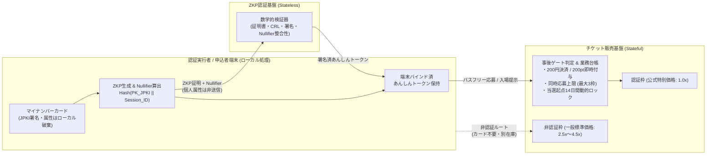

# あんしん正価モデル（Anshin-Seika Model）

**公的個人認証（JPKI）× ゼロ知識証明（ZKP）× 経済的インセンティブ設計（Financial WAF）による、次世代の適正価格流通インフラ設計**

[](https://creativecommons.org/licenses/by-nc-sa/4.0/deed.ja)


---
「あんしん正価モデル」は、チケットや限定品等のデジタル流通市場における**自動化プログラム（BOT）を用いた大量購入や高額転売といった課題**に対し、従来の「アクセス検知と一律遮断（BAN）」ではなく、**暗号学的な匿名一意性証明と経済的インセンティブ設計（Financial WAF）**によって大量仕入れの期待ROI（投資対効果）を構造的に低下させ、経済合理性の観点から自発的な撤退を促すシステムアーキテクチャおよび経済モデルです。

---

## 1. 設計のコア思想（3つの柱）

1. **属性判別・恣意性の排除と「等しく小さな不便」の割り振り**
   「誰が転売目的か」を運営者が主観的に監視・選別するのではなく、すべての利用者に等しく小さな手間と制約（JPKIカード読取、少額デポジット、同時応募枠上限、当選後の動的ロック）を課します。一般観客にとっては許容可能な微小コストである一方、数百〜数千口規模の大量購入・転売を行う主体にとっては資金効率や回転率が構造的に低下し、収益性が成立しなくなります。
2. **ゼロ知識証明（JPKI-ZKP）による完全なプライバシー保護と非連結性**
   マイナンバーカードの署名用電子証明書に含まれる個人属性（基本4情報）および公開鍵（$PK_{JPKI}$）はクライアント端末内で処理・破棄し、サーバーへ一切送信・保存しません。公演固有の `Session_ID` をソルトとした一方向性ハッシュ $\text{Nullifier} = \text{Hash}(PK_{JPKI} \parallel \text{Session\_ID})$ により、「同一公演内での1人1トークン制限」と「別公演間での名寄せ不能（Unlinkability）」を両立します。
3. **非認証ルートの存置と価格非対称性（Financial WAF）**
   マイナンバーカード非保有者や訪日客を排除しないよう「非認証ルート（一般標準価格枠）」を別在庫プールとして併設しつつ、定価の2.5倍〜4.5倍の価格設定を適用することで、認証枠の当選機会保護と、非認証枠における仕入れコストの上昇を通じた過剰購入リスクの低減を同時に実現します。

---

## 2. システム全体像（信頼境界の分離）

本アーキテクチャは、業務状態を持たない**ステートレスなZKP認証基盤**と、抽選・ロック・ポイント管理を担う**ステートフルなチケット販売基盤**を厳格に分離しています。



---

## 3. リポジトリ構成（Directory Structure）

本リポジトリは、システム間インターフェースと状態遷移を定義する**リファレンス仕様層**と、経済的効果を定量検証する**シミュレーション層**の2つで構成されています。

```text
anshin-seika/
├── README.md                                        # プロジェクト全体概要・ナビゲーション（本ファイル）
├── anshin-seika-reference/                          # 【システム設計】リファレンスアーキテクチャ仕様書一式
│   ├── readme.md                                    # 全体概要・設計思想・信頼境界・実運用拡張ガイドライン
│   ├── sequences/                                   # コア業務シーケンス図（Mermaid）
│   │   ├── 01_zkp_auth_and_token_issuance.md        # ゼロ知識認証およびあんしんトークン発行
│   │   ├── 02_lottery_entry_and_cap.md              # 抽選応募および同時3枠上限
│   │   ├── 03_lottery_result_and_lock.md            # 抽選確定・当落分岐・14日間動的ロック
│   │   └── 04_resale_and_venue_entry.md             # 未払いキャンセル・機種変更・リセール・会場入場
│   └── specs/
│       └── token_state_transition.md                # あんしんトークン全5ステータス遷移仕様・5つの不変条件
└── anshin_seika_sim/                                # 【経済検証】大量購入・転売ROI検証シミュレーター
    ├── README.md                                    # シミュレーターの使い方・実行方法
    ├── SPEC.md                                      # 数理モデル・評価指標・損益分岐点の仕様書
    ├── PARAMETERS.md                                # シミュレーションパラメータ定義書
    ├── anshin_seika_sim.py                          # Pythonシミュレーション実行スクリプト
    └── results/                                     # 検証出力データ（CSV）
        ├── result_axis1_scale.csv                   # 規模軸（組織スケール別）の期待ROI検証結果
        └── result_axis2_rate.csv                    # 比率・レート軸（価格倍率・販売比率別）の検証結果
```

---

## 4. 関連ドキュメント・公開情報

- **全体構想・ビジネス／法制度モデル（note）**
  - [あんしん正価モデル ホワイトペーパー ＆ コアロジック定義書（v1.1.1）](https://note.com/naochan_toiresj/n/n33b88b0b5b00)
    - 設計思想（Financial WAF）、ファンクラブ経済圏でのポイント還流、景品表示法（二重価格表示）との調和、3段階の導入ロードマップを解説しています。
- **技術解説・図解記事（Zenn）**
  - [JPKI×ZKPとFinancial WAFによるチケット転売の経済的抑止設計「あんしん正価モデル」](https://zenn.dev/naochan_t_souji/articles/76bc6555ab2cd3)
    - アーキテクチャ全体像、4枚の図解フロー、状態遷移の不変条件およびシミュレーション検証結果を解説しています。
- **技術アーキテクチャ詳細（本リポジトリ内）**
  - [リファレンスアーキテクチャ仕様書 (`anshin-seika-reference/readme.md`)](anshin-seika-reference/readme.md)
  - [トークン全ステータス遷移仕様 (`anshin-seika-reference/specs/token_state_transition.md`)](anshin-seika-reference/specs/token_state_transition.md)
- **経済検証シミュレーション（本リポジトリ内）**
  - [シミュレーター概要 (`anshin_seika_sim/README.md`)](anshin_seika_sim/README.md) / [数理仕様 (`anshin_seika_sim/SPEC.md`)](anshin_seika_sim/SPEC.md)
- **その他発信（X）**
  - X（旧Twitter）でも、本モデルに関する考察や時事ニュースへの見解を発信しています。

---

## 5. 本リポジトリの位置づけ・利用方針

本プロジェクトは、特定の実装や商用サービスの提供を目的としたものではなく、**個人による思考実験・プロトタイプ設計の公開**です。

* **個別サポート・要望対応は行いません**：著者のリソースの都合上、個別の質問・機能要望・IssueやPull Requestへの返信・対応は原則として行いません。あらかじめご了承ください。
* **自由なフォーク・発展を歓迎します**：本設計は「たたき台（素材）」として公開しています。ライセンスの範囲内であれば、許可や連絡なしで自由にフォーク・改変・独自検証を行い、各自の環境や課題に合わせて発展させてください。

---

## 6. ライセンスおよび免責事項（License & Disclaimer）

* **ライセンス**: 本リポジトリ内のドキュメントおよびソースコードは **[CC BY-NC-SA 4.0（表示 - 非営利 - 継承 4.0 国際）](https://creativecommons.org/licenses/by-nc-sa/4.0/deed.ja)** のもとで公開されています。著者名（なおちゃんトイレそうじ）および本リポジトリへのリンクを明記し、同一ライセンスを継承する限り、非営利目的での自由な検証・改変・再配布が可能です。
* **免責事項**: 本リポジトリの仕様およびシミュレーション結果は概念実証（PoC）および思考実験の共有を目的としたものであり、特定のシステム実装・法的適合性・経済効果を保証するものではありません。実運用への適用にあたっては、各事業者の自己責任において法務確認およびセキュリティ監査を実施してください。
