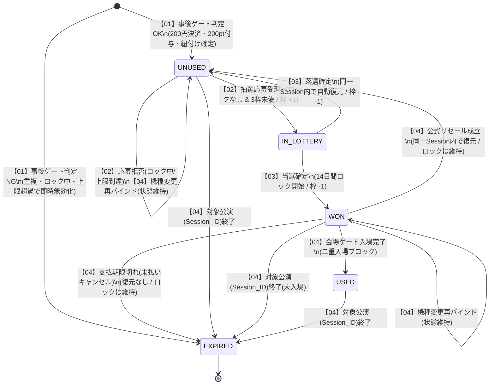

# あんしんトークン 全ステータス遷移仕様

## 1. ステータス定義一覧

チケット販売基盤の台帳上で管理される、あんしんトークン（`Nullifier + 連番 + 認証基盤署名`）の状態定義は以下の5種類です。

| ステータス名 | 内部コード | 概要・性質 | 同時応募枠（最大3枠）のカウント |
| --- | --- | --- | --- |
| **未消費（有効）** | `UNUSED` | 発行直後、または落選・リセール成立により復元された状態。対象公演（`Session_ID`）内での抽選応募・リセール購入に使用可能。 | カウント外（`0`） |
| **消費済み（抽選応募中）** | `IN_LOTTERY` | 抽選エントリーが受理され、当落確定待ちの状態。他公演への二重使用や同時応募上限の計算対象となる。 | **カウント対象（`+1`）** |
| **消費済み（当選確定）** | `WON` | 抽選で当選が確定した状態（入金待ち・決済完了・入場前を含む）。この状態への遷移と同時に会員IDへ「14日間動的ロック」が発動する。 | カウント外（確定時に `-1` 解放） |
| **使用完了（入場済）** | `USED` | 会場ゲートでのパスフリー検証を通過し、入場が完了した状態。二重入場防止のため再提示不可。 | カウント外（`0`） |
| **失効** | `EXPIRED` | トークンのライフサイクルが完全に終了した終端状態。いかなる理由でも復元・再利用不可。 | カウント外（`0`） |

---

## 2. 状態遷移図（State Diagram）

---

## 3. 全ステータス遷移マトリクス

各フェーズ（`01`〜`04`）で発生するイベントごとの状態変化と、付随する業務ルール（14日間ロック・アクティブ応募枠・課金/ポイント）の挙動一覧です。

| 参照 | 現在の状態 | 発生イベント（トリガー） | 遷移後の状態 | アクティブ枠変動 | 14日間ロック・その他付随処理 |
| --- | --- | --- | --- | --- | --- |
| `01` | （未発行） | 認証コールバック到達・事後ゲート判定 **OK** | **`UNUSED`** | 変化なし | 200円決済確定・200pt即時付与。`会員ID + Session_ID + トークン` を1対1対1で登録。 |
| `01` | （未発行） | 認証コールバック到達・事後ゲート判定 **NG** *(重複 / ロック中 / 3枠上限超過)* | **`EXPIRED`** *(即時無効)* | 変化なし | 応募権を付与せず破棄。200円は現金返金せず所定のポイント変換処理のみ適用。 |
| `02` | `UNUSED` | 抽選応募リクエスト **受理** *(ロックなし ＆ 応募数 < 3)* | **`IN_LOTTERY`** | **`+1`** | 対象公演の認証枠（公式特別価格）抽選プールへエントリー確定。 |
| `02` | `UNUSED` | 抽選応募リクエスト **拒否** *(14日間ロック中 または 3枠上限到達)* | **`UNUSED`** *(変化なし)* | 変化なし | 応募は門前払いとなるが、トークン自体は消費されず有効なまま維持される。 |
| `03` | `IN_LOTTERY` | 抽選バッチ結果：**当選確定** | **`WON`** | **`-1`** | **★起点：該当 `会員ID` に対し「14日間動的ロック」を開始。** 公式特別価格での決済/請求確定。 |
| `03` | `IN_LOTTERY` | 抽選バッチ結果：**落選確定** | **`UNUSED`** *(自動復元)* | **`-1`** | 同一 `Session_ID`（同公演の2次受付・リセール）限定で再利用可能。優遇スコア加算。 |
| `04` | `WON` | 支払期限切れによる **未払いキャンセル** | **`EXPIRED`** *(復元不可)* | 変化なし | 座席在庫は回収・再循環。トークンは復元せず失効。**★14日間ロックは解除せず維持。** |
| `04` | `UNUSED` / `WON` | 端末破損・機種変更による **再バインド完了** | **現在状態を維持** *(`UNUSED` / `WON`)* | 変化なし | 会員IDの年間手続き回数を `+1`（上限年 $N$ 回）。200円決済・200pt付与。旧端末のバインドを強制失効し新端末へ付け替え。 |
| `04` | `WON` | **公式リセール出品・売買成立**（出品者側） | **`UNUSED`** *(同一Session復元)* | 変化なし | 出品者へ代金精算。トークンは同一 `Session_ID` 内限定で復元。**★14日間ロックは解除せず維持。** |
| `04` | `WON` | **会場ゲートでの入場検証完了** | **`USED`** | 変化なし | 端末バインド検証によりパスフリー入場許可。以後の再入場（二重提示）をブロック。 |
| `04` | `UNUSED` / `WON` / `USED` | **対象公演（`Session_ID`）の終了** | **`EXPIRED`** | 変化なし | セッションの有効期限満了により、該当公演に紐づく全トークンを完全失効。 |

---

## 4. リファレンス仕様における不変条件（Invariants）

実装および検証（テスト）において、いかなる遷移パスを通っても**絶対に違反してはならない4つの制約**です。

1. **セッション境界の厳守（Cross-Session Isolation）**:
* `UNUSED` への復元（落選時・リセール成立時）が発生しても、そのトークンが有効なのは**発行時に紐づいた同一の `Session_ID`（対象公演）内のみ**であり、他公演への流用は一切できない。

2. **ロックの不可逆性（Irreversible Lock）**:
* 一度 `WON`（当選確定）へ遷移して発動した「14日間動的ロック」は、その後に `EXPIRED`（未払いキャンセル）や `UNUSED`（公式リセール成立）へ遷移しても、**期間満了（14日経過）まで絶対に解除・短縮されない**。

3. **終端状態の不可逆性（Terminal State）**:
* 一度 `USED`（入場済）または `EXPIRED`（失効）に到達したトークンが、再び `UNUSED` や `WON` に戻るパスは存在しない。

4. **物理実存と台帳の一対一対応（1-to-1 Binding）**:
* 機種変更（再バインド）完了時、旧端末側のバインド情報は即座に無効化され、同一のトークンが2台の端末で同時に有効（クローン状態）になる瞬間を作らない。